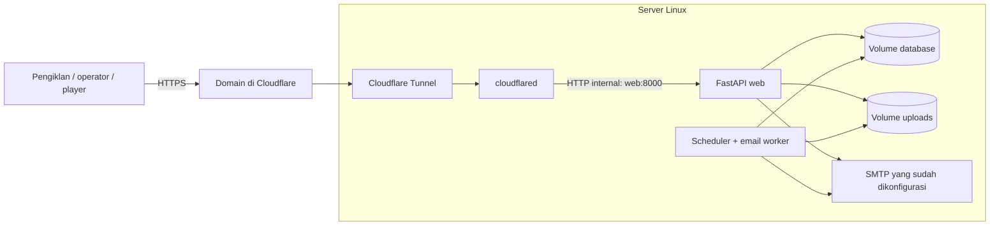

# Deployment LAMIA melalui Cloudflare

> **Jalur full Cloudflare Free:** gunakan [panduan khusus `cloudflare/`](cloudflare/README.md) untuk Workers + D1 + Workers KV tanpa VPS/R2. Panduan di bawah tetap mendokumentasikan jalur FastAPI + VPS + Tunnel yang terpisah.

Panduan disusun 9 November 2026 berdasarkan kode repository dan dokumentasi resmi yang ditautkan di bawah. Dokumen ini adalah rencana deployment; belum ada server, DNS, tunnel, atau container yang dijalankan.

## 1. Apakah LAMIA bisa dihosting di Cloudflare?

**Bisa menggunakan Cloudflare, tetapi repository ini belum siap dipindahkan langsung ke Workers/Pages tanpa adaptasi.** Jalur yang paling sesuai untuk implementasi sekarang adalah **VPS Linux + Docker Compose + Cloudflare Tunnel**. Aplikasi dan penyimpanan berjalan di VPS; Cloudflare menyediakan akses melalui domain publik. Tunnel tetap membutuhkan server/VM untuk menjalankan konektornya. [Dokumentasi Tunnel](https://developers.cloudflare.com/tunnel/get-started/).

| Pilihan | Kesesuaian dengan kode saat ini |
| --- | --- |
| VPS + Docker Compose + Cloudflare Tunnel | Opsi utama: memakai FastAPI, scheduler, SMTP, FFmpeg, dan volume persisten yang sudah tersedia |
| Cloudflare Pages untuk aset statis | Hanya menyajikan frontend; API dan proses backend tetap harus disediakan |
| Python Workers | FastAPI didukung, tetapi entrypoint, dependensi, penyimpanan, pengiriman pesan, dan proses background perlu diadaptasi |
| Cloudflare Containers | Dapat memakai image Docker melalui konfigurasi Workers/Containers; file Compose dan named volume lokal tidak otomatis menjadi layanan/persistent disk Cloudflare |

Python Workers memiliki dukungan FastAPI/ASGI dan paket Python/WebAssembly; dukungan framework tidak berarti seluruh kode server Linux ini langsung kompatibel. [FastAPI](https://developers.cloudflare.com/workers/languages/python/packages/fastapi/), [paket Python](https://developers.cloudflare.com/workers/languages/python/packages/).

Pada Containers, disk secara default bersifat sementara dan instance yang dimulai kembali dapat memakai disk baru. Snapshot/FUSE memiliki model tersendiri; keduanya bukan pengganti otomatis volume SQLite bersama yang digunakan LAMIA. [Lifecycle dan storage Containers](https://developers.cloudflare.com/containers/faq/).

## 2. Arsitektur yang digunakan dalam langkah berikut



`web` dan `scheduler` memakai image yang sama serta berbagi volume `database` dan `uploads`. Compose saat ini memaksa mode production dan menonaktifkan scheduler tertanam pada web. Scheduler terpisah menangani perubahan status dan retry email.

## 3. Siapkan server dan domain

1. Siapkan VPS Linux dengan disk persisten, akses SSH, dan koneksi keluar ke SMTP serta Cloudflare.
2. Instal Docker Engine dan plugin Docker Compose mengikuti panduan distribusi server. Contoh untuk Ubuntu: [instalasi resmi Docker](https://docs.docker.com/engine/install/ubuntu/).
3. Periksa pemasangan pada server:

```sh
docker --version
docker compose version
```

4. Tambahkan domain ke akun Cloudflare dan selesaikan aktivasi DNS/nameserver sesuai instruksi dashboard.
5. Tentukan subdomain aplikasi, misalnya `lamia.example.com`. Ganti seluruh contoh domain pada dokumen ini dengan domain Anda.
6. Salin repository ke server, misalnya `/opt/lamia`, tanpa menyertakan virtual environment lokal. File `.env` berisi kredensial dipindahkan melalui kanal yang Anda kendalikan, bukan commit Git.

Untuk koneksi tunnel pada firewall terbatas, periksa persyaratan outbound Cloudflare, termasuk port 7844. Akses publik ke port aplikasi 8000 tidak diperlukan pada rancangan ini. [Persiapan jaringan Tunnel](https://developers.cloudflare.com/tunnel/get-started/).

## 4. Lengkapi `.env` server

Dari direktori repository di server:

```sh
cd /opt/lamia
[ -f .env ] || cp .env.example .env
chmod 600 .env
```

Pertahankan konfigurasi SMTP yang sudah benar. Lengkapi nilai berikut melalui editor:

```dotenv
APP_ENV=production
APP_SECRET=ISI_SECRET_ACAK_MINIMAL_32_KARAKTER
ADMIN_USERNAME=admin
ADMIN_PASSWORD=ISI_PASSWORD_KUAT_MINIMAL_12_KARAKTER
PUBLIC_BASE_URL=https://lamia.example.com

OPERATOR_NAME=Nama badan usaha Anda
OPERATOR_ADDRESS=Alamat usaha Anda
SUPPORT_EMAIL=support@example.com

ENABLE_DEMO_OTP=false
ENABLE_DEMO_PAYMENTS=false

BANK_NAME=Nama bank
BANK_ACCOUNT=Nomor rekening
BANK_HOLDER=Nama pemilik rekening

SMTP_HOST=server-smtp-yang-sudah-Anda-gunakan
SMTP_PORT=465
SMTP_SECURE=true
SMTP_ENCRYPTION=ssl
SMTP_FROM=noreply@domain-Anda
SMTP_USERNAME=USERNAME_SMTP_ANDA
SMTP_PASSWORD=PASSWORD_SMTP_ANDA

PHONE_OTP_WEBHOOK_URL=https://adapter-ponsel-Anda/otp
PHONE_OTP_WEBHOOK_TOKEN=TOKEN_ADAPTER_ANDA

DOCKER_BIND_ADDRESS=127.0.0.1
PORT=8000
```

Semua nilai di atas merupakan placeholder, bukan kredensial siap pakai. Production menolak secret/password bawaan atau placeholder yang dikenali aplikasi; jangan memakai contoh sebagai kata sandi.

Hal yang khusus berlaku pada repository ini:

- `PUBLIC_BASE_URL` harus sama dengan origin HTTPS yang dibuka pengguna. Nilai ini dipakai untuk pemeriksaan origin login/CSRF dan tautan status dalam email.
- Cookie admin memakai `Secure` di production. Login dilakukan melalui domain HTTPS, bukan HTTP langsung ke IP server.
- Email selalu memakai SMTP sungguhan. Ponsel memerlukan adapter karena simulasi dimatikan di production.
- Jadwal production harus dimulai minimal 24 jam ke depan dan berdurasi minimal 24 jam.
- Compose menimpa `DB_PATH` menjadi `/data/videotron.db`; pengaturan path lokal di `.env` tidak memindahkan database host secara otomatis.
- Gunakan token perangkat yang didaftarkan melalui admin. `DEVICE_TOKEN` development tidak berlaku di production.

## 5. Jalankan backend pada VPS

Perintah berikut hanya contoh untuk Anda jalankan di server:

```sh
docker compose -f docker-compose.yml config --quiet
docker compose -f docker-compose.yml up -d --build
docker compose -f docker-compose.yml ps
docker compose -f docker-compose.yml logs --tail=100 web scheduler
curl -fsS -o /dev/null -w '%{http_code}\n' http://127.0.0.1:8000/api/v1/screens
```

Harapkan respons `200` dan kedua service sehat. Validasi video menggunakan FFmpeg yang sudah terpasang di image. Belum perlu membuka port 8000 ke Internet.

Volume Docker baru berisi database baru. Jika perlu membawa pesanan lama, hentikan penulisan pada aplikasi sumber dan rencanakan pemindahan database beserta seluruh unggahan sebelum menerima transaksi di server baru. Jangan menganggap file `videotron.db` lokal sudah termasuk image.

## 6. Buat Cloudflare Tunnel

Di dashboard Cloudflare, buka **Networking → Tunnels**, buat tunnel bernama misalnya `lamia-production`, lalu pilih lingkungan Docker. Ambil token dari petunjuk instalasi dan simpan sebagai rahasia. Nama menu dapat berubah; ikuti dashboard akun bila berbeda. [Pembuatan tunnel](https://developers.cloudflare.com/tunnel/get-started/), [pengelolaan token](https://developers.cloudflare.com/tunnel/reference/tunnel-tokens/).

Di server, salin template token terpisah dengan `cp .env.cloudflare.example .env.cloudflare`, lalu edit isinya:

```dotenv
TUNNEL_TOKEN=SALIN_TOKEN_TUNNEL_DARI_DASHBOARD
```

Lindungi file tersebut. Nama `.env.cloudflare` sudah tercantum pada `.gitignore`:

```sh
chmod 600 .env.cloudflare
```

File ini hanya diberikan kepada `cloudflared`, sehingga konektor tidak menerima password admin atau SMTP aplikasi. Token dapat diberikan melalui variabel `TUNNEL_TOKEN`. [Parameter cloudflared](https://developers.cloudflare.com/tunnel/reference/run-parameters/).

## 7. Tambahkan service tunnel pada server

Repository sudah menyediakan `docker-compose.cloudflare.yml` dengan isi berikut. File ini baru digunakan jika disebutkan lewat opsi `-f`; belum ada tunnel yang dijalankan.

```yaml
services:
  cloudflared:
    image: cloudflare/cloudflared:latest
    command: ["tunnel", "--no-autoupdate", "run"]
    env_file:
      - .env.cloudflare
    depends_on:
      web:
        condition: service_healthy
    restart: unless-stopped
    init: true
    read_only: true
    cap_drop:
      - ALL
    security_opt:
      - no-new-privileges:true
    logging:
      driver: json-file
      options:
        max-size: "10m"
        max-file: "3"
```

Service ini bergabung ke jaringan Compose yang sama dengan `web`. Gunakan versi/digest image yang telah diuji bila Anda membutuhkan rilis yang tetap, alih-alih mengikuti `latest`.

Jalankan kedua file secara konsisten:

```sh
docker compose -f docker-compose.yml -f docker-compose.cloudflare.yml config --quiet
docker compose -f docker-compose.yml -f docker-compose.cloudflare.yml up -d --build
docker compose -f docker-compose.yml -f docker-compose.cloudflare.yml logs --tail=100 cloudflared
```

Gunakan `config --quiet` untuk validasi tanpa mencetak hasil konfigurasi yang dapat berisi kredensial.

## 8. Hubungkan hostname publik

Pada tunnel yang dibuat, buka **Routes → Add route → Published application** dan isi:

| Pengaturan | Nilai contoh |
| --- | --- |
| Hostname | `lamia.example.com` |
| Service URL | `http://web:8000` |

Simpan route dan periksa record DNS yang dibuat dashboard. Jika hostname sudah mempunyai record yang berbeda, periksa konflik sebelum menggantinya. [Published application routes](https://developers.cloudflare.com/tunnel/get-started/#publish-an-application).

**Gunakan `web:8000`, bukan `localhost:8000`:** `localhost` di container `cloudflared` menunjuk ke container konektor sendiri. Port internal web tetap 8000 walaupun port host di `.env` berbeda.

Pengunjung membuka `https://lamia.example.com`; hop HTTP pada contoh hanya berada di jaringan internal Docker. Terapkan pengalihan HTTP ke HTTPS untuk hostname publik. Pengaturan TLS pada contoh Tunnel ini berbeda dari skenario Cloudflare langsung ke origin HTTPS dengan sertifikat origin.

## 9. Atur cache dan akses API

Mulai dengan satu **Cache Rule: Bypass cache** untuk hostname aplikasi:

```text
(http.host eq "lamia.example.com")
```

Jangan membuat aturan Cache Everything untuk domain ini. Login, data pesanan, invoice, status review, manifest, dan aset player memerlukan autentikasi atau data terbaru. Aplikasi sudah memberi `no-store` pada sejumlah respons sensitif; jangan menimpanya dengan Edge Cache TTL. [Perilaku cache](https://developers.cloudflare.com/cache/concepts/default-cache-behavior/), [pengaturan Cache Rules](https://developers.cloudflare.com/cache/how-to/cache-rules/settings/).

Pastikan aturan challenge/Access yang Anda pilih tidak membuat API player menerima halaman login/challenge HTML sebagai pengganti JSON atau media. Player tetap memerlukan token perangkat LAMIA dan berhenti menayangkan kampanye jika izin server tidak diperbarui selama 30 detik.

Untuk media videotron dengan trafik produksi, periksa produk dan ketentuan Cloudflare yang sesuai. Bypass cache tidak otomatis menyelesaikan pembatasan layanan terkait distribusi video/file besar. R2/Stream dapat dipertimbangkan sebagai tahap integrasi terpisah; aplikasi ini belum memakainya. [Ketentuan CDN Cloudflare](https://www.cloudflare.com/service-specific-terms-application-services/).

## 10. Verifikasi melalui domain publik

```sh
curl -sS -o /dev/null -w '%{http_code}\n' https://lamia.example.com/api/v1/screens
curl -sS -o /dev/null -w '%{http_code}\n' https://lamia.example.com/api/v1/admin/orders
```

Respons yang diharapkan: `200` untuk katalog dan `401` untuk API admin tanpa login. Kemudian verifikasi melalui browser:

1. Workspace, logo, favicon, panduan, dan kalender tampil.
2. Menu operasional meminta username/password; login, logout, serta tindakan admin berjalan tanpa kesalahan CSRF.
3. Email OTP sungguhan diterima dan kedua kontak dapat diverifikasi.
4. PNG/JPG/MP4 yang sesuai dapat diajukan; review menimbulkan email menunggu dan keputusan.
5. Tautan email membuka status dari domain HTTPS yang benar tanpa memberi akses admin atau perubahan pesanan.
6. Checkout mengirim tagihan; konfirmasi dana mengirim email dan invoice PDF.
7. Perangkat dapat didaftarkan, player terhubung, heartbeat muncul, dan scheduler mengubah status pada waktu yang benar.

Header proxy juga perlu diperiksa: `PUBLIC_BASE_URL` menyelesaikan kebutuhan origin publik aplikasi, tetapi tidak otomatis mengubah `request.client.host`. Pada konfigurasi proxy default, pembatasan login berbasis IP dapat melihat IP konektor bersama. Bila perlu IP pengguna asli, siapkan rantai proxy tepercaya yang memvalidasi/menimpa header dari Cloudflare; jangan sekadar mempercayai seluruh `X-Forwarded-For` kiriman klien.

## 11. Pemeliharaan, backup, dan diagnosis

Semua perintah operasional setelah penambahan tunnel memakai pasangan file yang sama:

```sh
docker compose -f docker-compose.yml -f docker-compose.cloudflare.yml ps
docker compose -f docker-compose.yml -f docker-compose.cloudflare.yml logs --tail=100 web scheduler cloudflared
```

- Cadangkan volume `database` dan `uploads` bersama-sama. Database mencakup pesanan, sesi, token perangkat yang di-hash, serta antrean email. Gunakan backup SQLite yang konsisten atau hentikan web/scheduler selama pengambilan backup.
- Simpan `.env` dan token tunnel secara aman di luar backup yang dibagikan. Pertahankan `APP_SECRET` saat redeploy agar sesi dan tanda tangan pesanan tidak berubah tanpa sengaja.
- `docker compose down` mempertahankan named volume; **`down -v` menghapus volume beserta data**.
- `502`: periksa kesehatan web dan Service URL `http://web:8000`.
- Login gagal di production: periksa HTTPS, `PUBLIC_BASE_URL`, username/password, cookie Secure, dan pemblokiran 15 menit akibat percobaan gagal.
- Upload `413`: aplikasi membatasi 20 MB; batas Cloudflare juga dapat diturunkan pada zone. [Batas upload](https://developers.cloudflare.com/cache/concepts/default-cache-behavior/#upload-limits).
- Email tidak masuk: periksa SMTP/outbound server serta audit `EMAIL_RETRY`/`EMAIL_FAILED`. Cloudflare Tunnel bukan pengganti penyedia SMTP.
- Scheduler sehat tetapi email tertunda: periksa worker pengiriman dan audit; SMTP gagal tidak membatalkan transaksi tersimpan.

## 12. Deployment penuh menggunakan Cloudflare Free

Implementasi yang berdiri sendiri tersedia di [`cloudflare/`](cloudflare/README.md). Backend JavaScript Workers melayani API untuk frontend yang sama, D1 menyimpan transaksi, dan Workers KV menyimpan materi/invoice. Tidak ada VPS, R2, atau Containers pada jalur ini.

Ikuti panduan folder tersebut untuk resource baru, konfigurasi lokal Cloudflare, secrets, migrasi, pengujian, dan deploy. Jangan memakai `.env` atau database utama sebagai target migrasi. Data/token antardeployment tidak tersinkron otomatis.

Periksa batas kuota Workers Free, konsistensi KV, validasi media berbasis metadata, frekuensi scheduler satu menit, dan konfigurasi SMTP/OTP yang dijelaskan di sana. Jalur VPS + Tunnel pada bagian 3–11 tetap tersedia untuk backend Python dan FFmpeg.
